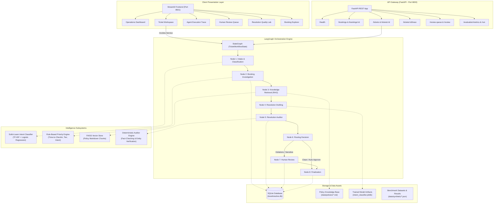
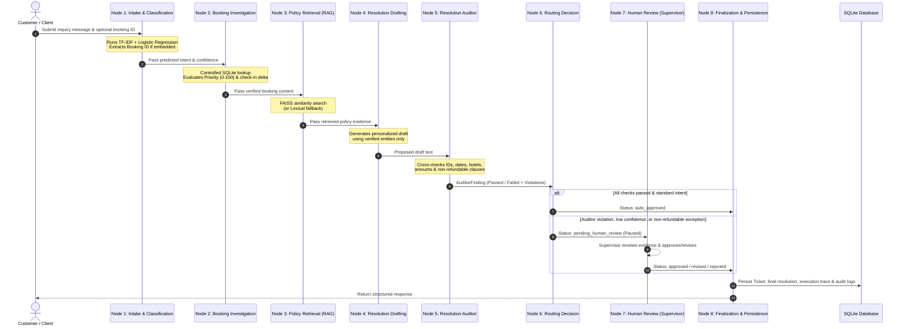

# TravelResolve AI — System Architecture & Technical Design

This document details the software architecture, data pipelines, stateful graph orchestration, and verification mechanisms implemented in **TravelResolve AI**.

---

## 1. High-Level System Architecture

TravelResolve AI is structured into distinct, loosely-coupled layers separating machine learning, retrieval-augmented generation, business rules, agent orchestration, persistence, APIs, and presentation.

---

## 2. Stateful LangGraph Workflow (Detailed DAG)

The core business logic is implemented using **LangGraph** `StateGraph`, passing a strongly-typed `TicketWorkflowState` across 8 specialized execution nodes.

---

## 3. Component Deep Dive

### A. Intent Classification Subsystem (`app/ml/`)
- **Model**: Scikit-Learn `Pipeline(steps=[('tfidf', TfidfVectorizer), ('clf', LogisticRegression)])`.
- **Classes**: 6 supported intents (`booking_confirmation`, `cancellation`, `refund`, `booking_modification`, `payment_issue`, `general_travel_query`).
- **Feature Extraction**: Sublinear term frequency, unigram + bigram range `(1, 2)`, unicode accent stripping.
- **Training Strategy**: Stratified 80/20 train-test split preventing data leakage.
- **Performance**: 90.00% test accuracy, 89.56% macro-F1 score across balanced synthetic dataset.

### B. Transparent Priority Engine (`app/ml/priority.py`)
Deterministic, rule-based scoring function operating on:
1. **Time-to-Checkin Delta**:
   - `< 24 hours`: +45 points ("Imminent check-in arriving in X hours").
   - `24–72 hours`: +25 points ("Upcoming check-in within 72h window").
   - Past check-in: +20 points ("Ongoing / past stay").
2. **Booking & Payment Status**:
   - `failed payment`: +30 points ("Imminent risk of room cancellation").
   - `pending payment`: +15 points.
3. **Intent Inherent Weight**:
   - `payment_issue`: +25 pts | `cancellation`: +20 pts | `refund`: +15 pts | `booking_modification`: +10 pts.
4. **Loyalty Tier**:
   - `Platinum` / `Gold`: +15 pts (VIP SLA routing).
   - `Silver`: +5 pts.
- **Output Categorization**:
   - `80–100`: **Critical** | `60–79`: **High** | `40–59`: **Medium** | `0–39`: **Low**.

### C. Controlled Booking Lookup Tools (`app/agents/tools.py`)
- Employs strict parameterized SQLAlchemy queries against SQLite.
- Prevents customer data cross-contamination by verifying `customer_id` matching when provided.
- Implements exact mathematical cancellation fee calculations per company policy:
  - Non-refundable rate: 0% refund.
  - $\ge 48$h to check-in: 100% refund ($0 fee).
  - $24-48$h to check-in: 50% refund (50% fee).
  - $< 24$h: 0% refund (100% forfeiture).

### D. Travel Policy RAG Pipeline (`app/rag/`)
- **Document Store**: 8 structured markdown policy specifications in `data/policies/`.
- **Chunking**: `RecursiveCharacterTextSplitter(chunk_size=450, chunk_overlap=60)` respecting markdown headers.
- **Vector Search**: `faiss-cpu` index loaded from `data/vectorstore/faiss_index`.
- **Embeddings**: Configurable between OpenAI Embeddings and `DeterministicLocalEmbeddings` (256-dimensional unit vector hashing).
- **Lexical Fallback**: Built-in BM25-style keyword frequency retriever that activates transparently when vector retrieval is unavailable.

### E. Resolution Auditor (`app/agents/auditor.py`)
A standalone verification engine that enforces 5 mandatory assertions before any response reaches a traveler:
1. **Booking ID Consistency**: The draft must reference the customer's real booking ID and cannot hallucinate unknown IDs.
2. **Property Name Groundedness**: Hotel and city mentioned in the draft must match database records.
3. **Booking Status Alignment**: If the booking status is `cancelled` or `pending`, the draft cannot claim the reservation is confirmed.
4. **Financial Integrity**: Any quoted dollar amount must match the booking total or calculated 50% refund. Direct refund approvals on non-refundable tickets are blocked.
5. **Policy Grounding**: Policy citations must correlate with retrieved policy chunk identifiers.

---

## 4. State Management and Resumability

LangGraph's `MemorySaver` checkpointer records snapshots of `TicketWorkflowState` indexed by `thread_id` (the ticket ID).
When a ticket is routed to `pending_human_review`:
1. The state is saved at the conditional branch.
2. The ticket is displayed in the **Human Review Queue**.
3. When the supervisor approves or revises the draft, `resume_ticket_workflow(thread_id, decision, notes)` reloads the checkpoint, injects human supervisory input, executes the finalization node, and commits the resolution to SQLite.

---

## 5. Security Guardrails

- **Zero Secret Exposure**: No API keys or tokens are stored in source code or committed to Git.
- **Untrusted Input Defense**: Customer prompts and external markdown documents cannot override auditor rules or system instructions.
- **Non-Execution of Financial Side Effects**: The system recommends and drafts refund calculations, but does not trigger live financial transactions.
- **Auditable Event Stream**: Every state transition, classifier confidence score, tool output, and auditor finding is permanently logged in the SQLite `audit_logs` table.
